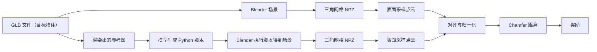

# 3D 奖励设计学习路径

## 目标

学完之后能独立判断这两件事：

1. RL 奖励应该对哪些差异保持不变：位置、尺度、水平朝向、上下朝向。
2. benchmark 里 `shape_chamfer.py` 的做法，哪些应该照搬，哪些应该改。

整条路径只讲做出这两个判断需要的 3D 知识，不展开建模、渲染算法等无关内容。每一步都用本项目的真实数据动手验证，脚本放在 `docs/learn/`。

## 总览：一条数据在本项目里的完整路径

后面每一步都对应这条链上的一个环节。

## 第 1 步：网格（mesh）是什么

- **内容**：
  - 顶点（vertices）是 N×3 的坐标数组。
  - 面（faces）是 M×3 的整数数组，每行记录三个顶点的下标，组成一个三角形。
  - 一个形状可以用完全不同的顶点和三角形划分来表示。
- **类比**：同一张图片可以用不同分辨率存储，网格的"分辨率"就是三角形的疏密。
- **动手**：打开书桌的 NPZ，看顶点和面的数组；比较书桌（约 1560 个顶点）和蘑菇（约 676 万个顶点）。
- **检验问题**：为什么不能直接逐个顶点比较两个网格？

## 第 2 步：场景、对象与坐标变换

- **内容**：
  - 一个场景里有多个对象。每个对象的顶点存储在自己的"局部坐标"里，再通过一个 4×4 的变换矩阵（平移、旋转、缩放）放到"世界坐标"中。
  - 修改器（modifier）和实例（instance）会在导出时展开成真实几何。
  - 这就是 `export_mesh.py` 要乘 `matrix_world` 的原因。
- **类比**：局部坐标加变换矩阵，相当于一个张量再加一个仿射变换。
- **动手**：在 Blender 里创建一个立方体，平移并缩放后导出，对比局部坐标和世界坐标。
- **检验问题**：如果导出时忘了乘变换矩阵，奖励会出现什么错误？

## 第 3 步：GLB 文件里装了什么

- **内容**：
  - GLB 是 glTF 格式的二进制打包版本，里面有网格、节点树（对象和变换）、材质和贴图。
  - 奖励只用到其中的几何部分，材质和贴图都被忽略。
  - 数据集里每个对象有两个 GLB：彩色版和灰色版（`_grey`）。
- **动手**：列出书桌 GLB 里的节点、网格和材质。
- **检验问题**：提示词要求模型重建材质，这对奖励有没有影响？

## 第 4 步：坐标系约定（和 bug 直接相关）

- **内容**：
  - 右手坐标系。
  - "哪根轴向上"：Blender 是 Z 轴向上，glTF 是 Y 轴向上。
  - 单位是米。
  - 导入和导出时会自动转换坐标轴。
- **动手**：同一个书桌 GLB，分别用 Blender 和 trimesh 读取，对比包围盒（之前已经测过：竖直方向分别落在 Z 轴和 Y 轴上）。
- **检验问题**：benchmark 的 `cd_yawmin` 为什么是错的？`cd_axismin` 为什么不受影响？

## 第 5 步：参考图是怎么来的，丢掉了哪些信息

- **内容**：
  - 渲染就是用相机拍摄 3D 场景。
  - 相机的位置、朝向和视野决定了图片内容。
  - 自动取景会让物体在画面里的大小保持差不多，所以绝对尺寸丢失了。
  - 四张图是绕物体转一圈拍的，但不知道每张的方位角。
- **动手**：并排看几个物体的四张图（书桌、门、楼梯），对照它们真实的包围盒尺寸。
- **检验问题**：从图里能推断出位置、尺度、水平朝向、上下朝向中的哪几项？

## 第 6 步：表面采样，从网格到点云

- **内容**：
  - 先在三角形表面上按面积均匀撒点，把不同划分方式的网格变成可以比较的点集。
  - 采样点数和随机种子会给奖励带来噪声。
- **动手**：同一个网格用不同种子采样两次，算它们之间的 Chamfer 距离，这就是奖励的"噪声底"。再看点数从 1024 增加到 8192 时，噪声底怎么变化。
- **检验问题**：如果噪声底和"好结果与差结果之间的差距"差不多大，GRPO 训练会怎样？

## 第 7 步：Chamfer 距离的细节

- **内容**：
  - 两个方向分别在惩罚什么："目标到生成"惩罚缺失的部件，"生成到目标"惩罚多余的部件。
  - 平方距离和普通距离对离群点的敏感程度不同。
  - 两个方向是相加还是取平均。
  - Chamfer 距离的盲区：只看表面点，看不到内部结构，对薄结构不敏感。
- **动手**：对书桌做几种破坏，分别算距离：删掉一条桌腿、多加一个方块、整体平移、整体放大、旋转 90 度。
- **检验问题**：平移 10 厘米和删掉一条桌腿，哪个扣分更多？这个结果合理吗？

## 第 8 步：对齐与归一化（决策的核心）

- **内容**：
  - 平移归一化：用质心，还是用包围盒中心。
  - 尺度归一化：缩放到单位球（以最远点为准），还是除以包围盒对角线长度。
  - 旋转对齐：4 个水平朝向和 24 个轴对齐旋转分别包含什么；为什么不包含镜像。
  - 离群点怎样破坏"最远点"归一化。
- **动手**：
  - 用第 7 步的破坏样本，比较不同归一化方式下的距离。
  - 把书桌倒过来放，看 4 个旋转和 24 个旋转分别给多少分。
  - 给书桌加一个远处的小方块，看单位球归一化受到多大影响。
- **检验问题**：参考图看得出上下方向，奖励该不该原谅上下颠倒？

## 第 9 步：从距离到奖励（与你熟悉的训练部分衔接）

- **内容**：
  - GRPO 在每组回答内部做奖励标准化，所以对奖励做线性变换（加常数、乘系数）不影响训练，只有非线性映射的形状有影响。
  - 映射的饱和区和敏感区落在哪里。
  - 失败回答（得 0 分）和"成功执行但形状很差"的回答之间应该拉开多大差距。
- **动手**：在真实数据上统计距离分布，对比三种情况：随机两个不同物体之间、同一物体经过轻微扰动、同一物体经过严重扰动。再看 `exp(-d)` 在这些区间里的取值是否有区分度。
- **检验问题**：如果所有成功回答的奖励都挤在 0.9 到 0.95 之间，组内标准化之后会发生什么？

## 第 10 步：回到决策

重新审视之前的问题：

1. 奖励对位置、尺度、水平朝向、上下朝向分别是否保持不变。
2. 选哪种归一化方式。
3. 选哪种距离定义，以及怎样映射成奖励。
4. benchmark 的几个问题要不要先修，奖励要不要和它对齐。

> [!NOTE]
> 第 1 到 5 步是 3D 基础，以讲解为主，每步都有一个小实验；第 6 到 9 步直接服务于决策，以实验为主。我们按顺序一步一步来，每一步你理解了再进入下一步。
