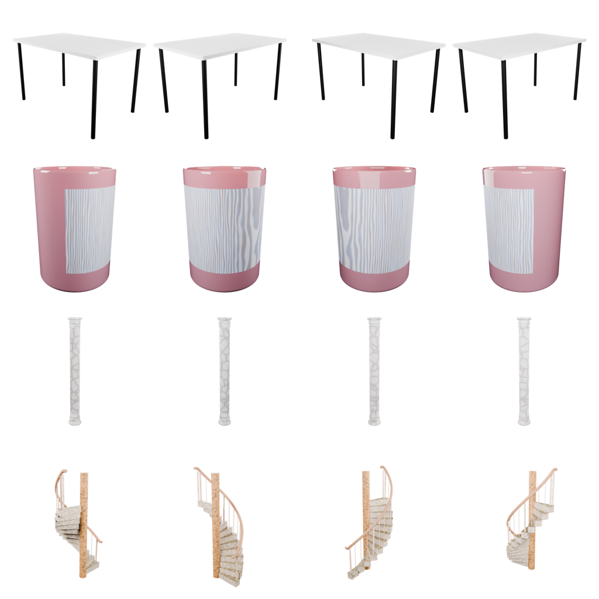

# 第 5 步：参考图是怎么来的，丢掉了哪些信息

实验脚本：[step5_renders.py](step5_renders.py)

```bash
pixi run python docs/learn/step5_renders.py
```

模型只能看到四张参考图。奖励却拿完整的 3D 几何去比较。所以要先弄清楚：从 3D 物体到图片，哪些信息保留了，哪些丢掉了。图里看不到的信息，奖励就不应该要求模型猜对。

## 1. 渲染就是用相机拍 3D 场景

**渲染**（rendering）是把 3D 场景变成一张 2D 图片的过程，相当于在场景里放一台虚拟相机拍照。拍出来的图片由三类因素决定：

| 因素 | 含义 |
|---|---|
| 相机位置 | 相机放在世界坐标系的哪个点 |
| 相机朝向 | 镜头对着哪个方向 |
| 视野 | 镜头的张角，张角越大，同样大小的物体在画面里显得越小 |

从 3D 到 2D 是一个**投影**：每个可见的表面点沿着视线落到画面上的一个像素，距离相机多远这一维信息就被压掉了。所以单张图片天然缺少深度信息，需要多张不同角度的图来互相补充。

## 2. 本项目的参考图

每个物体有四张 512×512 的参考图（`color_renders/Image_005.png` 等），背景透明。下面是四个物体的参考图，每行一个物体，从左到右依次是四个视角：



数据里没有保存相机参数，所以相机的具体位置、朝向和视野都只能从图片本身推断。

## 3. 绝对尺寸丢失了：自动取景

实验统计了每个物体在图中的高度（不透明像素的包围框），并和它的真实高度做对比：

```
物体                     真实高度(m)  图中高度(px)  每米像素   四张图的宽度(px)
CupFactory                     0.172           435      2524   [287, 287, 287, 287]
MushroomFactory                0.606           414       683   [291, 297, 296, 278]
SimpleDeskFactory              0.729           366       502   [459, 459, 459, 459]
LiteDoorFactory                2.691           389       145   [108, 113, 108, 113]
PillarFactory                  2.748           374       136   [54, 54, 54, 54]
SpiralStaircaseFactory         4.347           414        95   [167, 173, 167, 177]
```

真实高度从 0.17 米的杯子到 4.35 米的楼梯，相差 25 倍，但图中高度都在 366 到 435 像素之间。"每米像素"从 95 到 2524 不等，说明每个物体的相机都被调整过，让物体正好占满画面的大部分。这叫**自动取景**（auto-framing）。

结果是：图里的杯子比石柱还高。只看图片，无法知道物体的绝对大小。模型只能凭常识猜测，比如"桌子一般高 0.75 米左右"。对于常见物体，这种常识有一定作用；对于程序生成的植物、蘑菇这类物体，就很难猜准。

**位置也丢失了**：自动取景会把物体放在画面中间，所以图片看不出物体在世界坐标系里的位置。目标网格的"包围盒中心在原点"只是数据准备时的约定，不是从图里能看出来的信息。

## 4. 比例保留了

绝对尺寸虽然丢失，各部分之间的**比例**还在。书桌图中宽 459、高 366 像素；门宽约 110、高约 389 像素，一看就是又高又窄的形状。只要模型选定了一个整体尺寸，其他尺寸可以按图中比例推算出来。

所以模型生成的形状，理想情况下和目标只差一个整体缩放。这正是第 8 步要讨论的尺度归一化：先把两份几何缩放到同一个尺度，再比较形状。

## 5. 上下方向保留了

看拼图里的书桌和杯子：书桌的桌面上表面、杯子的杯口内侧都能看见。这说明相机位置比物体略高，向下俯视。四个视角都是这样，而且物体都是正立的：桌腿在下，桌面在上；楼梯从下往上盘旋。

所以从图里可以判断哪边朝上。这也是第 4 步讨论"奖励该不该原谅上下颠倒"时的关键依据。

## 6. 水平朝向基本丢失了

这一部分要分两层看。

**四张图之间的相对角度可以推断**：书桌是长方形的，从不同水平方向看，宽度一般会不一样。但它四张图的宽度完全相同（都是 459 像素），而且第 1、3 张一样，第 2、4 张是第 1 张的镜像。这符合"四个相机分别位于书桌的四个斜对角方向、彼此相隔 90°"的情况：从四个对角方向看一个左右前后都对称的长方形，投影宽度相同。文件编号 005、015、025、035 间隔相等，也和"绕物体转一圈均匀取四帧"的猜测一致。这是从图片推断出来的，数据里没有记录，我没有核实。

**第一张图对着世界坐标系的哪个方向，无法得知**：即使知道四个相机彼此相隔 90°，也不知道"第一张图的相机在物体的哪一侧"，即相对于世界坐标的 x、y 轴是多少度。提示词里也没有告诉模型这件事。所以模型建出来的物体，水平方向可能和目标差一个任意角度。

对于对称的物体，问题更严重：书桌四个方向看起来一样，连"哪一面是正面"都没有依据。对于不对称的物体（如楼梯），模型能从图里看出各部分之间的相对位置，但仍然不知道整体该朝哪个方向。

## 和奖励的关系

| 信息 | 能从参考图推断吗 | 依据 |
|---|---|---|
| 位置 | 不能 | 自动取景把物体放在画面中间 |
| 绝对尺度 | 不能，只能靠常识猜 | 自动取景让所有物体占满画面 |
| 各部分比例 | 能 | 投影保留比例 |
| 上下方向 | 能 | 相机略高于物体，物体正立 |
| 水平朝向 | 基本不能 | 不知道第一张图的相机方位角 |

奖励如果在"不能推断"的项目上扣分，扣的就是模型无法从输入中获得的信息，这部分分数差异对模型来说就是噪声。

## 检验问题

用自己的话说一说：上表中的五项，奖励分别应该怎样处理？也就是哪些差异该扣分，哪些差异应该在比较前先消除掉？

## 解答

原则是：**图里能看出来的差异要扣分，图里看不出来的差异要在比较前消除掉。**

| 信息 | 处理方式 | 具体做法（第 8 步展开） |
|---|---|---|
| 位置 | 比较前消除 | 两份几何各自平移，让中心对齐 |
| 绝对尺度 | 比较前消除 | 两份几何各自缩放到统一大小 |
| 各部分比例 | 扣分 | 这就是"形状"本身，是奖励要衡量的东西 |
| 上下方向 | 扣分 | 不对上下颠倒、侧放做补偿 |
| 水平朝向 | 比较前消除 | 绕竖直轴枚举几个角度，取距离最小的那个 |

水平朝向有一个细节：枚举 0°、90°、180°、270° 这 4 个角度，只能补偿"差 90° 整数倍"的情况。目标网格的主要结构都和坐标轴平行（例如书桌长边沿 y 轴），模型在 Blender 里建模时通常也沿坐标轴摆放，所以大多数情况下 4 个角度就够了。如果模型把物体转了 30° 这种任意角度，4 个角度补偿不了。是否需要更细的角度，等第 8 步用实验来看。
